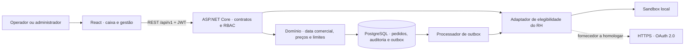
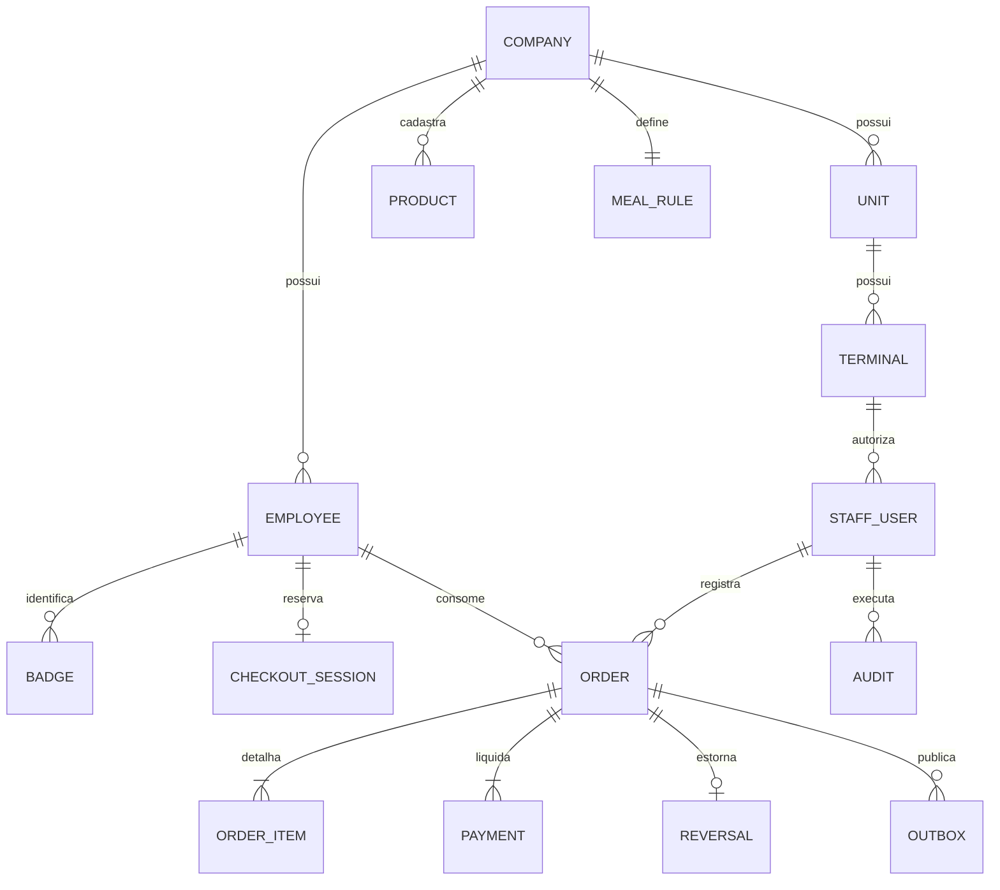

# Arquitetura e modelo de dados

As [migrations](../database/migrations) definem chaves e invariantes. O checkout bloqueia a linha do funcionário antes de verificar sessões, limites e as baixas do dia. Registros guardam preço e subsídio de cada item, operador, caixa, data comercial, instante e parcelas de pagamento. A associação empresa/unidade vem das credenciais de usuário. O worker retém somente o identificador externo do funcionário e os valores/itens indispensáveis para entrega ao RH.
